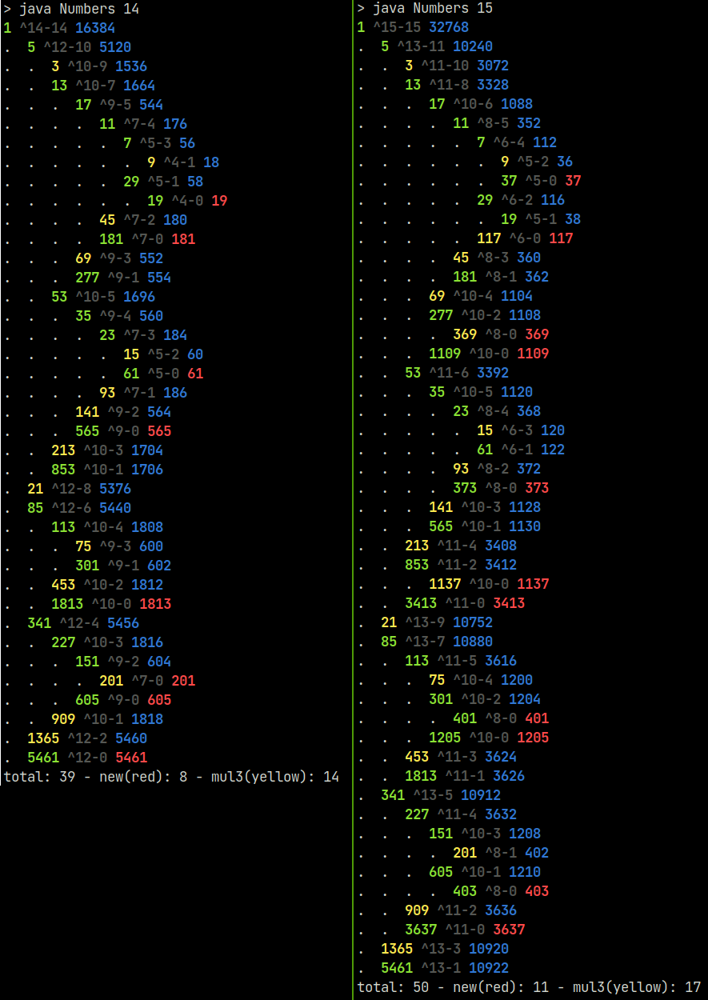

# 3n+1 problem proof and computer programs

A bit more in [makarenko-alexandre-3n+1.pdf](makarenko-alexandre-3n%2B1.pdf)

## New/different formulation

> Change 1 - Instead of dividing even numbers by 2 we add 1 shifted left by the number of trailing zeros T.

> Change 2 - The sequence ends when it reaches $2^{T_n}$. In other words, eventually there will be only single 1 shifted left by the number of divisions by 2 we would accomplish with the regular Collatz algorithm.

Example for **11**:

|step|old decimal|old binary|new binary|new decimal|
|---:|------:|--------:|----------:|------:|
|   0| **11**|     1011|       1011| **11**|
|    |     *3|   100001|     100001|     *3|
|    |     +1|   100010|     100010|     +1|
|    |     /2|    10001|     100010|    nop|
|   1| **17**|    10001|     100010| **34**|
|    |     *3|   110011|    1100110|     *3|
|    |     +1|   110100|    1101000|     +2|
|    |     /4|     1101|    1101000|    nop|
|   2| **13**|     1101|    1101000|**104**|
|    |     *3|   100111|  100111000|     *3|
|    |     +1|   101000|  101000000|     +8|
|    |     /8|      101|  101000000|    nop|
|   3|  **5**|      101|  101000000|**320**|
|    |     *3|     1111| 1111000000|     *3|
|    |     +1|    10000|10000000000|    +64|
|    |    /16|        1|10000000000|    nop|
|   4|  **1**|        1|10000000000|**1024**|

Each new sequence value $X_{i+1}$ will be : 

$$X_{i+1}=3X_i+2^{T_i}$$

where $T_i$ is the number of trailing zeros in the value $X_i$.


## Reverse algorithm

Given a value $X_{i+1}$ we can find all possible $X_i$ with 

$$X_i=(X_{i+1}-2^{T_i})/3$$

by evaluating all $T_i$ where 

$$0 \leq T_i < T_{i+1}$$

and

$$X_{i+1}-2^{T_{i}}\equiv 0\space\left(mod\space 3\right)$$

Example of all values reverted from $2^{10}$:

|step 0|step 1|step 2|step 3|step 4|step 5|     binary|
|-----:|-----:|-----:|-----:|-----:|-----:|----------:|
|**1024**|    |      |      |      |      |10000000000|
|      |   341|      |      |      |      |  101010101|
|      |   340|      |      |      |      |  101010100|
|      |      |   113|      |      |      |    1110001|
|      |   336|      |      |      |      |  101010000|
|      |**320**|     |      |      |      |  101000000|
|      |      |   106|      |      |      |    1101010|
|      |      |      |    35|      |      |     100011|
|      |      |**104**|     |      |      |    1101000|
|      |      |      |**34**|      |      |     100010|
|      |      |      |      |**11**|      |       1011|
|      |      |    96|      |      |      |    1100000|
|      |   256|      |      |      |      |  100000000|
|      |      |    85|      |      |      |    1010101|
|      |      |    84|      |      |      |    1010100|
|      |      |    80|      |      |      |    1010000|
|      |      |      |    26|      |      |      11010|
|      |      |      |    24|      |      |      11000|
|      |      |    64|      |      |      |    1000000|
|      |      |      |    21|      |      |      10101|
|      |      |      |    20|      |      |      10100|
|      |      |      |      |     6|      |        110|
|      |      |      |    16|      |      |      10000|
|      |      |      |      |     5|      |        101|
|      |      |      |      |     4|      |        100|
|      |      |      |      |      |     1|          1|


The backward algorithm is combinatorial where the values reverted from $2^{T_n}$ and $2^{T_n-1}$ never overlap.

Let's name $N_i$ the number of unique values produced by $2^{i}$. Since $2^{i}$ produces all values of $2^{i-2}$, $N_i$ will not include values of $2^{i-2}$. In our example above, $N_{10}=12$ : {1024, 341, 340, 113, 336, 320, 106, 35, 104, 34, 11, 96}, $N_{8}=6$ : {256, 85, 84, 80, 26, 24}.

$N_i$ is a function of $i$ which grows as $N_i=4 N_{i-1} / 3$. Examples of $N_i$ up to $i=80$:

| $i$ | $N_i$ | $\sum{N_i}$ | $\left(N_i-N_{i-1}\right)/N_{i-1}$ | Time,s |
|----:|-----------------:|-----------------:|---------:|-----:|
|   0 |                1 |                1 | 0.000000 |    0 |
|   1 |                1 |                2 | 0.000000 |    0 |
|   2 |                1 |                3 | 0.000000 |    0 |
|   3 |                1 |                4 | 0.000000 |    0 |
|   4 |                2 |                6 | 1.000000 |    0 |
|   5 |                3 |                9 | 0.500000 |    0 |
|   6 |                4 |               13 | 0.333333 |    0 |
|   7 |                5 |               18 | 0.250000 |    0 |
|   8 |                6 |               24 | 0.200000 |    0 |
|   9 |                8 |               32 | 0.333333 |    0 |
|  10 |               12 |               44 | 0.500000 |    0 |
|  11 |               18 |               62 | 0.500000 |    0 |
|  12 |               24 |               86 | 0.333333 |    0 |
|  13 |               31 |              117 | 0.291667 |    0 |
|  14 |               39 |              156 | 0.258065 |    0 |
|  15 |               50 |              206 | 0.282051 |    0 |
|  16 |               68 |              274 | 0.360000 |    0 |
|  17 |               91 |              365 | 0.338235 |    0 |
|  18 |              120 |              485 | 0.318681 |    0 |
|  19 |              159 |              644 | 0.325000 |    0 |
|  20 |              211 |              855 | 0.327044 |    0 |
|  21 |              282 |             1137 | 0.336493 |    0 |
|  22 |              381 |             1518 | 0.351064 |    0 |
|  23 |              505 |             2023 | 0.325459 |    0 |
|  24 |              665 |             2688 | 0.316832 |    0 |
|  25 |              885 |             3573 | 0.330827 |    0 |
|  26 |             1187 |             4760 | 0.341243 |    0 |
|  27 |             1590 |             6350 | 0.339511 |    0 |
|  28 |             2122 |             8472 | 0.334591 |    0 |
|  29 |             2829 |            11301 | 0.333176 |    0 |
|  30 |             3765 |            15066 | 0.330859 |    0 |
|  31 |             5014 |            20080 | 0.331740 |    0 |
|  32 |             6682 |            26762 | 0.332669 |    0 |
|  33 |             8902 |            35664 | 0.332236 |    0 |
|  34 |            11878 |            47542 | 0.334307 |    0 |
|  35 |            15844 |            63386 | 0.333895 |    0 |
|  36 |            21122 |            84508 | 0.333123 |    0 |
|  37 |            28150 |           112658 | 0.332734 |    0 |
|  38 |            37536 |           150194 | 0.333428 |    0 |
|  39 |            50067 |           200261 | 0.333840 |    0 |
|  40 |            66763 |           267024 | 0.333473 |    0 |
|  41 |            89009 |           356033 | 0.333209 |    0 |
|  42 |           118631 |           474664 | 0.332798 |    0 |
|  43 |           158171 |           632835 | 0.333302 |    0 |
|  44 |           210939 |           843774 | 0.333614 |    0 |
|  45 |           281334 |          1125108 | 0.333722 |    0 |
|  46 |           375129 |          1500237 | 0.333394 |    0 |
|  47 |           500106 |          2000343 | 0.333157 |    0 |
|  48 |           666725 |          2667068 | 0.333167 |    0 |
|  49 |           888947 |          3556015 | 0.333304 |    0 |
|  50 |          1185305 |          4741320 | 0.333381 |    0 |
|  51 |          1580518 |          6321838 | 0.333427 |    0 |
|  52 |          2107346 |          8429184 | 0.333326 |    0 |
|  53 |          2809845 |         11239029 | 0.333357 |    0 |
|  54 |          3746399 |         14985428 | 0.333312 |    0 |
|  55 |          4995078 |         19980506 | 0.333301 |    0 |
|  56 |          6660211 |         26640717 | 0.333355 |    0 |
|  57 |          8880688 |         35521405 | 0.333394 |    0 |
|  58 |         11840592 |         47361997 | 0.333297 |    0 |
|  59 |         15787976 |         63149973 | 0.333377 |    0 |
|  60 |         21050985 |         84200958 | 0.333356 |    1 |
|  61 |         28067940 |        112268898 | 0.333331 |    1 |
|  62 |         37423702 |        149692600 | 0.333326 |    1 |
|  63 |         49897977 |        199590577 | 0.333326 |    2 |
|  64 |         66531372 |        266121949 | 0.333348 |    3 |
|  65 |         88710360 |        354832309 | 0.333361 |    4 |
|  66 |        118280689 |        473112998 | 0.333336 |    5 |
|  67 |        157705535 |        630818533 | 0.333316 |    7 |
|  68 |        210272571 |        841091104 | 0.333324 |    9 |
|  69 |        280362436 |       1121453540 | 0.333329 |   12 |
|  70 |        373815696 |       1495269236 | 0.333330 |   17 |
|  71 |        498423661 |       1993692897 | 0.333341 |   22 |
|  72 |        664571765 |       2658264662 | 0.333347 |   30 |
|  73 |        886092554 |       3544357216 | 0.333329 |   39 |
|  74 |       1181447507 |       4725804723 | 0.333323 |   52 |
|  75 |       1575258367 |       6301063090 | 0.333329 |   71 |
|  76 |       2100349800 |       8401412890 | 0.333337 |   93 |
|  77 |       2800476278 |      11201889168 | 0.333338 |  128 |
|  78 |       3733966810 |      14935855978 | 0.333333 |  177 |
|  79 |       4978612219 |      19914468197 | 0.333331 |  235 |
|  80 |       6638155867 |      26552624064 | 0.333335 |  334 |

Running the command `java Numbers X` in `./src` displays all values for $N_{X}$. For example:



where each $j$-th value $X_{ij}$ produced from $2^{i}$ is displayed as 

$$ .\space\space\space\space.\space\space\space\space.\space\space\space\space v_{ij} \space \text{\textasciicircum} L-R\space\space X_{ij} $$

meaning $X_{ij}=v_{ij}\times2^{R}$ with L and R as left-most and right-most bits respectively. L for information only and the dotted indentation is the depth to display better the childhood relationship.

$v_{ij}$ are printed in green or yellow when $v_{ij}\equiv0\space\left(mod\space3\right)$. $X_{ij}$ are printed in blue or red when $R=0$.

$N_{i}$, in other words, is the number of all $X_{ij}$:

$$N_{i}=|\{X_{ij}\}|$$


Computing $\{v_{i+1,j}\}$ is producing exactly the same values as $\{v_{ij}\}$ since starting from $2^{i+1}$ provides only one trailing 0 more. Due to this 0, there are two possibilities for an $X_{i+1,j}$ coming from $X_{ij}$.

Either it is a double of the previous value (blue)

$$X_{i+1,j}=2X_{ij}$$

or occasionally new value (red)

$$X_{i+1,j}=2\left(X_{ij}-1\right)/3$$

This makes all $X_{ij}$ unique.


It is important to remark that 

1. Absolutely all $V_{i}=\{v_{ij}\}$ are naturally found in $V_{i+1}=\{v_{i+1,j}\}$ while none of $\{X_{ij}\}$ will exist in $\{X_{kj}\}$ for $k>i$.

2. The red values are the only new numbers between $V_{i+1}$ and $V_{i}$.

3. The yellow values never have children since they are multiple of 3 and $3K-2^{m} \not\equiv 0\space\left(mod\space 3\right)$ for any K and m.

Starting from $2^{i+1}$ doubles the number of possible values compared to $2^{i}$ but only $\frac{2}{3}$ of all numbers are green and will have children, so $N_{i+1}=2\frac{2}{3}N_{i}$.

This is also verifiable from computational results. Looking at the example above, one can notice that for every 8 rows $N_{i} \simeq 10N_{i-8}$. For instance

$$N_{70} = 373815696$$

$$N_{78} = 3733966810$$

In fact,

$$\left(\frac{4}{3}\right)^{8} \simeq 9.9887212$$

and

$$\frac{N_{78}}{N_{70}} \simeq 9.9887908$$

So more precisely

$$N_{i}=\left(\frac{4}{3}\right)^{8}N_{i-8}$$

> **Proof**.  By tending $n$ to infinity the backward sequences from $2^n$ and $2^{n-1}$ will produce all integers.
If any other cycle (not ending by 1) existed, it would lead to an infinite number of values breaking the counting function $N_i$.

## Code

In `src` all java files are standalone programs.

Count.java counts all unique numbers produced from $T_i$ to $T_i-2$.

```bash
$> javac Count.java
$> java Count 80
| $T_i$ | $N_i$ | $\sum{N_i}$ | $\left(N_i-N_{i-1}\right)/N_{i-1}$ | Time,s |
|----:|-----------------:|-----------------:|---------:|-----:|
|   0 |                1 |                1 | 0.000000 |    0 |
|   1 |                1 |                2 | 0.000000 |    0 |
|   2 |                1 |                3 | 0.000000 |    0 |
|   3 |                1 |                4 | 0.000000 |    0 |
...

```

Numbers.java displays all unique numbers produced from $T_i$ to $T_i-2$.


```bash
$> javac Numbers.java
$> java Numbers 10
1 ^10-10 1024
.  5 ^8-6 320
.  .  3 ^6-5 96
.  .  13 ^6-3 104
.  .  .  17 ^5-1 34
.  .  .  .  11 ^3-0 11
.  .  53 ^6-1 106
.  .  .  35 ^5-0 35
.  21 ^8-4 336
.  85 ^8-2 340
.  .  113 ^6-0 113
.  341 ^8-0 341
total: 12 - new(red): 4 - mul3(yellow): 2

```

